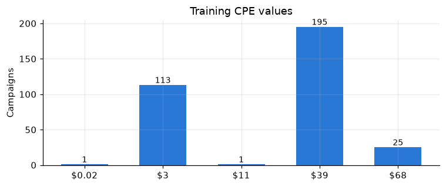
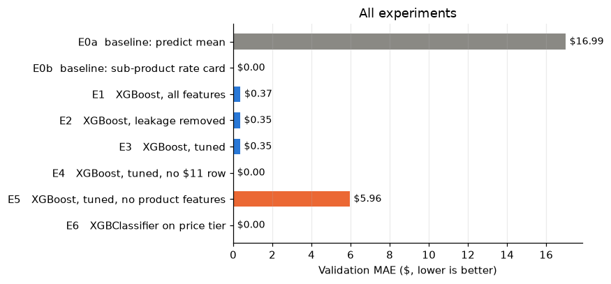
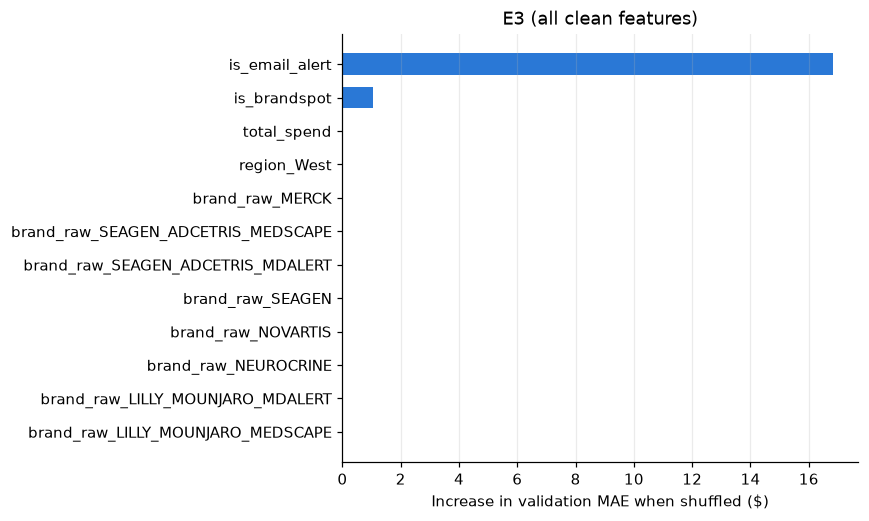
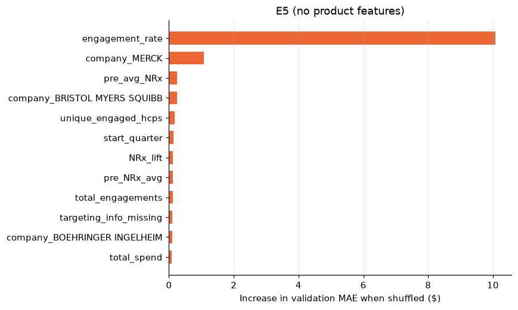

# Did That Campaign Work? Predicting Pharma Ad Performance

Break Through Tech AI Studio, Fall 2026 · Challenge Project with **WebMD**

We used historical pharmaceutical advertising data from WebMD to predict how campaigns perform and to find which campaign characteristics drive cost and spend. The goal is to help WebMD plan media budgets before the second half of the year by forecasting results by tactic, audience, and specialty.

---

## 👥 Team Members

| Name | GitHub Handle | Contribution |
|------|---------------|--------------|
| Abhiram Segu | [@Nightwolf7570](https://github.com/Nightwolf7570) | Data quality report for variables J to N; cleaned dataset artifact (`clean_dataset.ipynb`, `cleaned_df.csv`); linear regression baselines for CPE and total spend |
| Bakari Kerr | [@Bakari-K](https://github.com/Bakari-K) | Data quality report; CPE regression study comparing OLS, Ridge, and price lookups, including a planning-time feature set and label sensitivity checks |
| Emma Zhang | [@emz95](https://github.com/emz95) | Data quality report for variables E to H (`media_type`, `profession`, `specialty`, campaign dates); October final report with baseline metrics and findings |
| Nida Syed | [@NidaTah](https://github.com/NidaTah) | Data quality report; feature engineering (`notebooks_03_feature_engineering.ipynb`, `featured_df.csv`) |
| Rhea Coulthurst John | [@Qurash13](https://github.com/Qurash13) | Data quality report; additions to the cleaned dataset and model feature sets (`feature_sets.json`); categorical encoding and time-based train/validation split |
| Timothy Hsu | [@timmyhsu07](https://github.com/timmyhsu07) | Data quality report for NRx and specialty fields; cleaning decision log; CPE modeling with XGBoost, leakage analysis, and feature importance |

Some work lives on team branches that are not yet merged into `main`. Links to each are in [Repository Contents](#-repository-contents).

---

## 🎯 Project Highlights

- Built a cleaning, feature engineering, and encoding pipeline that turns 417 raw campaigns with 28 columns into a model-ready dataset with 161 features, with every cleaning choice documented in a decision log.
- Split the data by campaign start date (oldest 80% for training, newest 20% for validation) so models are tested on newer campaigns they have never seen.
- Found target leakage: total budget divided by total engagements reproduced CPE in 99% of rows. We removed the budget-based and CPE-derived features so models only use information available when a campaign is planned.
- Showed that CPE follows a fixed rate card set by product type (Email Alert $3, Condition Message $11, BrandSpot $68, all others $39). Linear regression, Ridge, and XGBoost all confirmed product type as the main driver, and a product lookup table predicted all 82 validation campaigns exactly.
- Established baselines for total spend, the harder target: neither a mean baseline nor linear regression meets the brief's targets yet, which sets the direction for November.

---

## 👩🏽‍💻 Setup and Installation

**1. Clone the repository**

```bash
git clone https://github.com/Break-Through-Tech/Pharma-1A-predicting-pharma-ad-performance.git
cd Pharma-1A-predicting-pharma-ad-performance
```

**2. Create an environment and install dependencies** (Python 3.10 or later)

```bash
python -m venv .venv
source .venv/bin/activate        # Windows: .venv\Scripts\activate
pip install -r requirements.txt
```

**3. Get the data.** The raw dataset provided by WebMD is at `data/BreakThroughTech_training_data_1.xlsx`.

**4. Run the pipeline in order.** Each step writes the file the next step reads.

| Step | Notebook | Reads | Writes |
|------|----------|-------|--------|
| 1. Cleaning | `notebooks/clean_dataset.ipynb` | raw `.xlsx` | `data/cleaned_df.csv`, `data/cleaned_df_encoded.csv`, `reports/feature_sets.json` |
| 2. Feature engineering | `notebooks_03_feature_engineering.ipynb` | `data/cleaned_df.csv` | `featured_df.csv` |
| 3. Encoding and split | `notebooks/04_encoding_and_split.ipynb` | `featured_df.csv` | `data/train_val_split/*.csv` |
| 4. Modeling | `notebooks/TimothyHsu_CPE_XGBoost_Model.ipynb` and the model notebooks on team branches | `data/train_val_split/*.csv` | results tables and figures |

**5. Train and evaluate.** Open a modeling notebook in Jupyter and run all cells:

```bash
jupyter notebook notebooks/TimothyHsu_CPE_XGBoost_Model.ipynb
```

Each modeling notebook trains its models, scores them on the validation set (MAE, RMSE, R², and the share of predictions within $1), and logs the results to one table. To load the prepared data in your own code:

```python
import pandas as pd

S = "data/train_val_split/"
X_train = pd.read_csv(S + "X_train.csv")
X_val = pd.read_csv(S + "X_val.csv")
y_train = pd.read_csv(S + "y_train.csv")["cpe"]
y_val = pd.read_csv(S + "y_val.csv")["cpe"]
```

---

## 🏗️ Project Overview

This project is part of the **Break Through Tech AI Program**, where Fellows work in teams on real machine learning problems from industry partners during AI Studio.

**Host company:** WebMD, a leader in digital health information that also runs advertising campaigns for pharmaceutical brands aimed at healthcare professionals (HCPs).

**Objective:** Use January to June campaign data to predict second-half campaign performance, including total spend, cost efficiency (CPE), and engagement, broken out by tactic type (Email Alert, Brand Alert, Sponsored Video, and others), client target segments, and HCP specialty.

**Why it matters:** Media budgets are set before campaigns run. If WebMD can forecast which tactic and audience combinations will be most cost-efficient, it can move budget toward them before the second half starts instead of reacting after the money is spent.

**Success criteria set by our Challenge Advisor:**
- Quantitative: MAPE below 30% and R² above 0.55 on held-out H2 campaigns.
- Business: explain which campaign characteristics most strongly predict spend or CPE.
- Process: documented cleaning decisions, a justified model choice, and reproducible notebooks.

---

## 📊 Data Exploration

**Dataset:** 417 pharmaceutical ad campaigns with 28 columns, delivered as an Excel file. Columns cover brand and product, media type and tactic, targeting (profession, specialty, NPI specialty, region, country), campaign dates, reach and engagement counts, budget and spend, and prescription volume before and after each campaign (NRx).

**Data quality review.** Each team member audited a group of columns and documented every issue, the rows affected, and a proposed fix. The decisions are collected in the [cleaning decision log](https://github.com/Break-Through-Tech/Pharma-1A-predicting-pharma-ad-performance/blob/data-cleaning-decision-log/notebooks/cleaning_decision_log.md). Main findings:

- **Placeholder end dates.** 414 of 417 campaigns have the same 2099 end date and the other 3 are null, so `campaign_end_date` was dropped and campaign length is not derived from it.
- **A block of missing targeting data.** 56 rows are missing `profession`, `specialty`, `country`, and `pillar` together, and 80 rows are missing `media_type`. Since the gaps are not random, nulls were recoded to `UNKNOWN` rather than filled with the most common value.
- **Mixed profession codes.** 296 rows use numeric codes (8, 99, 10 to 23) and 65 use text labels, with no codebook. Codes were kept as separate categories.
- **Sparse specialty.** Only 54 rows have a usable `specialty`, so the team used `npi_specialty` instead (0 nulls, 13 categories after cleanup).
- **Outliers and inconsistencies.** 34 prescription values were capped with the IQR rule, `NRx_lift` was recomputed in 106 rows where it was off by a cent, and one-off specialty and region labels were merged into existing categories.
- **Brand names.** 73 raw labels include the same company spelled several ways.

**Feature engineering** added 23 columns, including log transforms of skewed counts and spend, flags for key products (`is_email_alert`, `is_brandspot`, `is_target_list`), missing-data flags, and budget per day and per reach.

**Encoding.** The 14 text columns were one-hot encoded, with categories seen fewer than 5 times grouped into one "infrequent" column. The encoder was fit on training data only. The final dataset has 161 numeric features.

**Train/validation split.** Campaigns were sorted by start date. The oldest 80% (335 campaigns, Dec 2020 to Mar 2025) went to training and the newest 20% (82 campaigns, Mar 2025 to Apr 2026) to validation. Campaigns that started on the same day were kept in the same set.

**Key insight: CPE takes only a few values.** Each sub-product maps to one price.



---

## 🧠 Model Development

**Targets:** `cpe` (cost per engagement) and `total_spend`.

Team members built and compared different model families on the same split and scoring, so results line up directly:

| Model work | Owner | What it tests |
|------------|-------|---------------|
| Baselines and linear regression for CPE and spend | Abhiram Segu | Product-price lookup vs. linear regression for CPE; mean baseline vs. linear regression for total spend |
| OLS and Ridge regression for CPE | Bakari Kerr | Effect of leaky features, regularization, unusual labels, and a 99-feature planning-time set |
| XGBoost for CPE | Timothy Hsu | Leakage removal, 5-fold CV tuning, outlier sensitivity, product ablation, and classification by price tier |

**Leakage check.** Total budget divided by total engagements equals CPE in 99% of rows, so any budget-based feature hands the model the answer. The team removed `total_budget_spent`, its log, `budget_per_reach`, `budget_per_day`, `spend_near_zero`, `budget_anomaly`, `cpe_imputed`, `cpe_outlier`, and `product_tier`.

**Tuning.** XGBoost used a 5-fold cross-validated grid search over 48 configurations (best: learning rate 0.05, max depth 3, 300 trees). Ridge selected its regularization strength with cross-validation.

---

## 📈 Results & Key Findings

All models are scored on the same 82 validation campaigns.

**CPE**

| Model | Validation MAE | R² |
|-------|---------------:|---:|
| Predict training mean | $16.99 | −0.03 |
| Product-type lookup table | $0.00 | 1.00 |
| Linear regression on product type | $0.12 | 0.999 |
| Ridge, leaky features removed | $0.90 | 0.976 |
| Ridge, planning-time features only | $1.19 | 0.994 |
| XGBoost, leaky features removed and tuned | $0.35 | 0.973 |
| XGBoost, product features removed | $5.96 | 0.69 |
| XGBoost classifier on 3 price tiers | $0.00 | 1.00 |



**Total spend**

| Model | MAE | R² | MAPE |
|-------|----:|---:|-----:|
| Predict training mean | 1.47 B | −0.28 | 6,620% |
| Linear regression | 2.24 B | −2.97 | 7,073% |
| Target from the brief | – | > 0.55 | < 30% |

**Finding 1: product type sets CPE.** Email Alert costs $3, Condition Message $11, BrandSpot $68, and every other product $39. Compared with the most common price of $39, Email Alert costs 92% less and BrandSpot 74% more. No model beats a simple lookup table.



**Finding 2: without product type, the remaining signals mostly stand in for it.** With product features removed, XGBoost's R² drops to 0.69 and engagement rate becomes the strongest feature. Engagement rate is 0.40 for $3 campaigns and 0.18 for $39 campaigns, and pre-campaign prescriptions rise with price (about 44, 71, and 94 for the $3, $39, and $68 tiers).



**Finding 3: total spend is the real prediction problem.** Spend varies widely even within the same company and product (392 distinct values across 414 rows). Linear regression does worse than predicting the average and predicts negative spend for 20 of the 82 validation campaigns.

---

## 🚀 Next Steps

- **Model `log(total_spend)` with tree-based models** using only information available before a campaign, working toward R² above 0.55 and MAPE below 30%.
- **Evaluate the final model on the H2 held-out set** and present methodology, results, and business recommendations.
- **Resolve open data questions with our Challenge Advisor:** a codebook for profession codes, whether two zero-spend campaigns are real, the units of `total_spend` (its median is about 1,800 times `total_budget_spent`), and which of `pre_avg_NRx` and `pre_NRx_avg` is correct.
- **Stretch goals from the brief:** cluster campaigns before regression, add SHAP explanations for individual predictions, and build a data quality check for new records.

---

## 📁 Repository Contents

**On `main`**
- `Challenge-Project-Overview.md`: project brief from WebMD
- `data/`: raw data, cleaned data, and the train/validation split
- `notebooks/`: cleaning, encoding and split, data quality reports, and the XGBoost model
- `notebooks_03_feature_engineering.ipynb`, `featured_df.csv`: feature engineering
- `reports/`: encoding report, feature sets, and figures

**On team branches**
- [Cleaning decision log](https://github.com/Break-Through-Tech/Pharma-1A-predicting-pharma-ad-performance/blob/data-cleaning-decision-log/notebooks/cleaning_decision_log.md)
- [October final report](https://github.com/Break-Through-Tech/Pharma-1A-predicting-pharma-ad-performance/blob/emma-october-report/reports/october_final_report.md)
- [Linear regression for CPE and total spend](https://github.com/Break-Through-Tech/Pharma-1A-predicting-pharma-ad-performance/blob/abhiram-baseline-linear-model/notebooks/AbhiramSegu_CPE_Linear_Regression.ipynb)
- [OLS and Ridge regression for CPE](https://github.com/Break-Through-Tech/Pharma-1A-predicting-pharma-ad-performance/blob/Bakari-Kerr-16-task-4-regression-model/notebooks/BakariKerr_CPE_Regression_Model.ipynb)
- Data quality reports: [variables E to H](https://github.com/Break-Through-Tech/Pharma-1A-predicting-pharma-ad-performance/blob/emma-data-quality-report/notebooks/data_quality_report_variables_E-H.ipynb), [Bakari Kerr](https://github.com/Break-Through-Tech/Pharma-1A-predicting-pharma-ad-performance/blob/8-task-1-data-quality-report---bakari-kerr/notebooks/Milestone1.ipynb), [Nida Syed](https://github.com/Break-Through-Tech/Pharma-1A-predicting-pharma-ad-performance/blob/9-task-1---nida-syed/notebooks/BTT.ipynb)

---

## 📝 License

To be chosen with our Challenge Advisor's approval.

---

## 📄 References

- [scikit-learn Supervised Learning Guide](https://scikit-learn.org/stable/supervised_learning.html)
- [scikit-learn Preprocessing](https://scikit-learn.org/stable/modules/preprocessing.html)
- [XGBoost Python Documentation](https://xgboost.readthedocs.io/en/stable/python/)
- [SHAP Documentation](https://shap.readthedocs.io/)

---

## 🙏 Acknowledgements

Thank you to our Challenge Advisor from WebMD, our AI Studio Coach, and the Break Through Tech team for their guidance and support throughout AI Studio.
